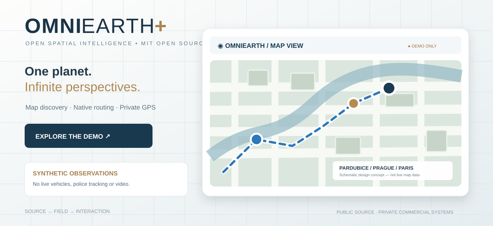
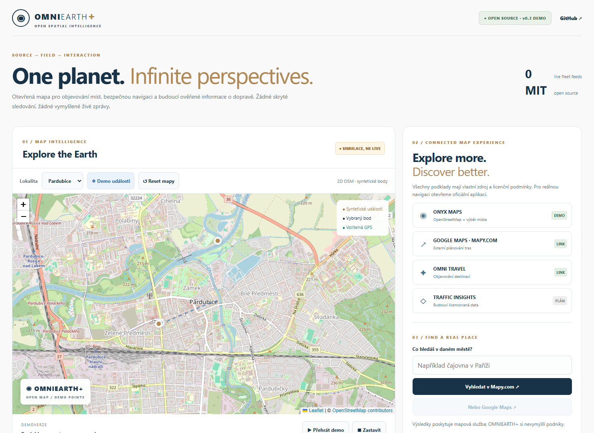
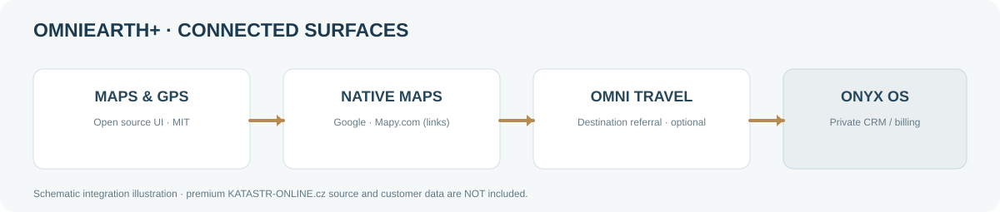

# 🌍 OMNIEARTH+  
### Open Spatial Intelligence · by OMNIVERSUM



**Current running v0.3 desktop preview (real Chrome screenshot):**



*Real screenshot of the local demo; all map events are synthetic, and the map background is OpenStreetMap.*

[](LICENSE)  

**An open-source spatial viewer for map discovery, privacy-conscious navigation, and future verified public road observations.**

> **This is an open, synthetic-data demonstration. It is not Google Earth, an actual traffic feed, a police-patrol locator, or a live fleet tracking service.** All animated vehicle points and road observations are fictional. Real-world navigation opens licensed external providers.

## ✨ Explore the demo

- Responsive map experience for iPad, phones, and desktop.
- Pardubice, Prague and Paris starter locations; point selection and route handoff.
- Street map from OpenStreetMap *(small development demo only; attribution and OSMF usage limits apply)*.
- External **Google Maps** and **Mapy.com** search / navigation links; never mix providers' protected tiles.
- Permission-based browser GPS, explicit stop, no hidden background uploads.
- **Traffic intelligence roadmap**: official or licensed traffic jams, collisions, construction, closures and travel-time reliability — **no unverified police locations**.
- A clear public/private boundary: the private **KATASTR-ONLINE.cz** premium service and ONYX OS payments/CRM are **not part of this repository**.
- OMNI TRAVEL public destination links are referrals, **not** confirmed purchases or revenue.
- Optional future **OMNISHOP couriers** may provide authorized anonymized road events after a funded pilot and legal review; **not implemented**.


*Vector design illustration, not a screenshot or proof of live telemetry.*

## 🚀 Start

No API keys needed. Serve the static site locally (Node 20+):
```bash
npm start
# http://127.0.0.1:4174
npm test
```

Demo is static and can also be served from any compliant static host. External map tiles require network access. `index.html` alone is not guaranteed to support all module behaviors using `file://`.

## 🔐 Open source ≠ public customer data

| Open under MIT | Kept private or separately licensed |
| --- | --- |
| UI, architecture, synthetic observations, routing link generators | KATASTR-ONLINE.cz premium source & reports |
| Generic source adapters and published test fixtures | ONYX OS / OMNIVERSUM CRM, payments, partner data |
| Documentation and onboarding | Google/Mapy map imagery, commercial 3D keys, real fleet video |
| Safe public place/map handoffs | Real-time location trails, personal data, contracts |

No raw camera streams, faces, plates, employee GPS trails, property-owner contact datasets, tokens, or private CRM exports are accepted in this public repository.

## 🧭 Provider strategy

For now Google Maps and Mapy.com are **native external URLs**, not installed embedded vendor APIs. OpenStreetMap community-run tiles are used for this low-traffic demo only; production scale needs an approved provider and quota controls. Google 3D Tiles and licensed Mapy.com APIs are future, budget-gated adapters.

## 💼 Partners and contribution

We welcome geospatial, mobility, accessibility, transport and privacy-by-design contributors. Genuine partnerships are evaluated in private ONYX OS systems; there is no live paid pilot or direct CRM sync in this demo.

See [architecture](docs/ARCHITECTURE.md), [roadmap](docs/ROADMAP.md), [security](SECURITY.md), and [contribution guidelines](CONTRIBUTING.md). Report security problems privately; do not post tracking traces or sensitive imagery in issues.

## 🧅 Optional .onion access

An onion-service mirror could eventually offer privacy-preserving access to public documentation, but is **not deployed** and is **not** required for routing. See [privacy channel note](docs/ONION.md).

## License

MIT applies to **our source code and illustrations** only. Third-party maps, tiles, trademarks, photos, vendor data and video streams are subject to their own rights and terms.

**Built for responsible geospatial exploration. Source → Field → Interaction.**
